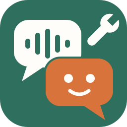

<p align="center"></p>

# Voice interaction: two prototypes for designing an agent that talks

Two tools that let design students work on the **identity of a voice agent** (its voice, its personality) and on the **basic vocabulary of voice UX**: taking turns, knowing when someone has finished, interrupting, thinking, not understanding, visual and sound feedback, and calls to action.

| | engine | for whom, for what |
|---|---|---|
| [**1. The cables.gl op "VoiceAgent"**](1_cables_gemini_live/) | Gemini Live (online) | design in cables.gl, with the smoothest voice available today. An op you paste into the cables editor, without touching the cables code. |
| [**2. The "Voice Lab" app**](2_qvac_local/) | QVAC (100% local, open models) | a Windows / Mac M1 app, installed on each computer, with no cloud and no key. It has its own lab window, and the cables op can connect to it. |

Both speak **the same vocabulary** ([`CONTRACT.md`](CONTRACT.md)): same states, same events, same settings. An interface designed in cables works with Gemini today and with the local engine tomorrow: only the `Engine` port changes.

## What you can explore, and with what

| design question | settings | signals for the interface |
|---|---|---|
| **Who is the agent?** | Name, Persona, Creativity, Short answers, Greeting | — |
| **Which voice?** | Voice (30 Gemini voices; locally, 10 Supertonic voices, a voice described in words with Parler, or Chatterbox), Speaking style, Speed | Voice level (a mouth, a glow) |
| **When have you finished speaking?** | End silence (impatient ↔ patient), Start sensitivity and End sensitivity, End of turn (local: silence only, or silence + Smart Turn) | Hearing, On user end, Mic level, Turn probability (local) |
| **Can you interrupt it?** | Interruptible, Listen while speaking, Interrupt button, Interrupt after (local: a "mm-hm" lets it carry on, "stop" makes it stop) | On interruption, On interruption pending, On interruption cancelled |
| **What happens while it thinks?** | Reply delay (latency as a design material), Thinking sound, Filler lines (local: "Hmm, let me see…") | Thinking, On thinking, On filler, Wait (ms) |
| **What if it didn't understand?** | Repair line (local) | On not understood, live transcripts |
| **What if the person says nothing?** | Away after, Reprompt line ("Are you still there?") | On away |
| **How do you show it's listening?** | Earcons (off, soft, clear) | the states, the levels, the subtitles |
| **How do you offer an action?** | On-screen choices and mood, Tools (JSON) | Choices, Question, Mood, Tool call → Choose, Tool result |
| **Typing instead of talking, informing without interrupting** | Text + Send text, Context + Send context | — |

Every turn is measured: `speech` (how long the person spoke), `firstSound` (the wait you feel, between the end of your sentence and the agent's voice) and `total`. So you can compare design choices with numbers.

### Borrowed from open source

Some features come from what other open-source voice projects do well (see [the open-source landscape](docs/OPEN_SOURCE_LANDSCAPE.md)). Most of them work with the local engine only:

- **the Smart Turn end-of-turn model** (Pipecat's Smart Turn v3.2, BSD-2): a small model that hears whether your sentence sounds finished. A complete sentence ends the turn quickly; a pause in the middle waits for the silence;
- **interruption that tolerates backchannels**: when you talk over the agent, its voice dips first. A "mm-hm" lets it carry on, "stop" makes it stop and listen, and a real sentence interrupts it;
- **spoken fillers**: a short "Hmm, let me see…" when the reply is slow;
- **away and reprompt** (both engines): an event when the person stays silent, and a line said once ("Are you still there?");
- **three local voice engines**: Supertonic (10 preset voices, the default), **Parler** (you describe the voice in words, English only) and **Chatterbox** (multilingual, and it can clone a voice).

## The documentation

- [**`docs/GUIDE.md`**](docs/GUIDE.md): the full guide. It covers getting started, the edge cases one by one (voice, personality, end of turn, interruption, thinking, not understanding, silence from the person, calls to action), workshop exercises, visual references and open course resources, the architecture, troubleshooting and the limits.
- [**`docs/HUMAN_TESTS.md`**](docs/HUMAN_TESTS.md): the test protocol to run yourself, on real machines and with real students, to check that the kit does what was asked. The ★ tests make up a quick run of about 2½ hours.
- [**`docs/OPEN_SOURCE_LANDSCAPE.md`**](docs/OPEN_SOURCE_LANDSCAPE.md): what already exists in open source, and what the kit borrowed from it.
- [**`CONTRACT.md`**](CONTRACT.md): the shared vocabulary (states, events, settings, the local engine protocol), and how it maps to other toolkits (LiveKit, Pipecat, ElevenLabs, Home Assistant).
- [**`PUBLISHING.md`**](PUBLISHING.md): how to put the kit on GitHub and publish the Voice Lab installers as a release.

## Getting started

- **With cables.gl and Gemini**: [`1_cables_gemini_live/README.md`](1_cables_gemini_live/README.md). In short: "Code a new op", paste `VoiceAgent.op.js`, add a Gemini key, click Start.
- **With the local app**: [`2_qvac_local/README.md`](2_qvac_local/README.md). The installers come from the repository's **Releases** page on GitHub: GitHub Actions builds them for Windows and Apple Silicon Macs each time you tag a version (see [`PUBLISHING.md`](PUBLISHING.md)). You can also build them yourself with `npm run make`.

## The folder

```
common/voice-core.js          the shared core (browser): mic, voice, states, events, Gemini and local engines
CONTRACT.md                   the vocabulary: states, events, settings, local engine protocol, mapping to other toolkits
1_cables_gemini_live/
  VoiceAgent.op.js            ← the op to paste into cables (generated by build.mjs = voice-core + op-glue)
  op-glue.js, build.mjs       the op's ports, the assembly
  token-server/               small Gemini token server (so the key stays out of the browser)
2_qvac_local/                 the Electron app "Voice Lab"
  electron/main.cjs           the app: built-in server, window, mic, menus
  src/                        the voice server (session, QVAC engine, simulated engine, text), the self-test
  src/turn/                   Smart Turn: the end-of-turn model and its audio features (a JavaScript port of Pipecat's)
  models/                     the Smart Turn v3.2 model (8.7 MB, BSD-2) and its license
  public/index.html           the lab window (persona, sliders, face, subtitles, measurements)
  personas/                   example personas (museum, station, gardener, chef)
  forge.config.cjs            packaging (Windows .exe, Mac .dmg) with QVAC's Forge plugin
docs/GUIDE.md                 the full guide (getting started, edge cases, exercises, architecture, troubleshooting)
docs/HUMAN_TESTS.md           the human test protocol
docs/OPEN_SOURCE_LANDSCAPE.md what already exists in open source
tests/                        the automated tests (see tests/README.md)
  run-all.mjs                 runs every suite and prints a summary (npm test)
  tools/, fixtures/           Smart Turn reference scripts (Python) and their reference values
.github/workflows/            tests.yml (the tests, on every push to main) and release.yml (installers → GitHub Release)
package.json                  npm test, and Playwright for the browser tests
PUBLISHING.md                 how to publish on GitHub and cut a release
LICENSE                       MIT, for the kit's own code
THIRD_PARTY_NOTICES.md        the licenses of the parts that come from elsewhere
```

## What has been checked

In total, **344 automated checks** pass (1 more is skipped here, see below). Run them all from the root with `npm test` (or `node tests/run-all.mjs`). On GitHub, they run on every push to `main` and on every pull request.

- **The cables op**: 89 checks in Chromium, with a fake mic, against a fake Gemini Live server. This fake server speaks the official protocol, and it is just as strict: an unknown field closes the session. They cover the setup sent, audio, turns, choices, tools, interruptions (by voice, by gesture, by text or a choice while it speaks, with or without Gemini's confirmation), context, away and the reprompt, stopping during connection or the mic request, the token server, session resumption and errors. The op runs exactly as cables runs it, in the body of a class constructor in strict mode.
- **The local app**: 62 checks in Chromium (lab window and cables op on the local engine, with the simulated engine, including a 2nd page taking over, the voice dipping for a "mm-hm", spoken fillers, away and the voice engine fields) and 49 protocol checks (including Smart Turn, stop phrases and fillers). On top of that, 46 checks of the QVAC adapter against a fake SDK, which checks the options passed to QVAC (Supertonic, Parler and Chatterbox) and accepts only one recognition stream at a time, like QVAC. Finally, 23 checks of the Electron process with a fake Electron, including the Windows installer.
- **Smart Turn**: 41 checks. The JavaScript audio features match Pipecat's Python reference, and the real model, run through Python's onnxruntime, gives exactly the same probabilities on both. The skipped check is the real prediction through `onnxruntime-node`, which could not be installed here.
- **The text** (sentence splitting, cleanup for the voice, tags): 34 checks.
- **Not yet checked for real**:
  - **the real Gemini API**, since there was no key here;
  - **the real QVAC models** (including Parler and Chatterbox) and **the Electron packaging**, which the build environment could not install;
  - **Smart Turn inside the app** (`onnxruntime-node` in Electron, the model in the installers) and its accuracy on real voices.

  First steps on a real machine: tests A1 to A7 and A12 of the [human test protocol](docs/HUMAN_TESTS.md). The full list of what remains to be checked is in [the guide](docs/GUIDE.md) (section 8).

## License

The kit's own code is under the MIT license ([`LICENSE`](LICENSE)). The parts that come from elsewhere (the Smart Turn model, QVAC, the voice models…) keep their own licenses: see [`THIRD_PARTY_NOTICES.md`](THIRD_PARTY_NOTICES.md).
