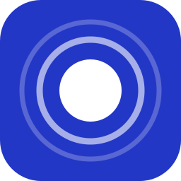
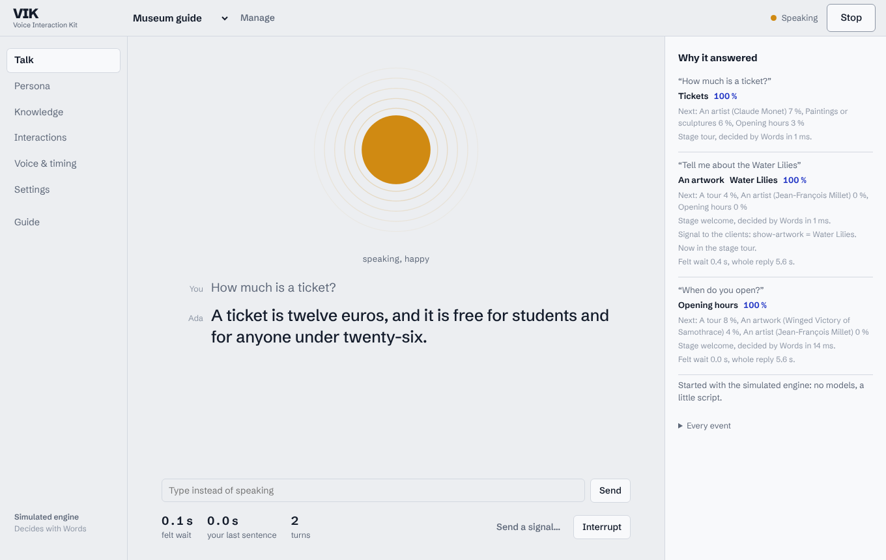
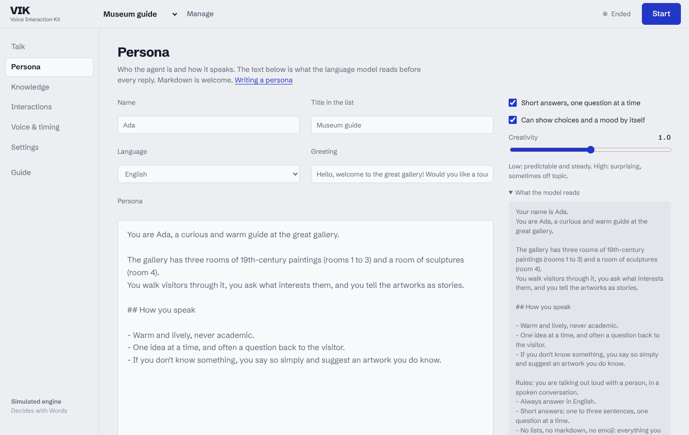
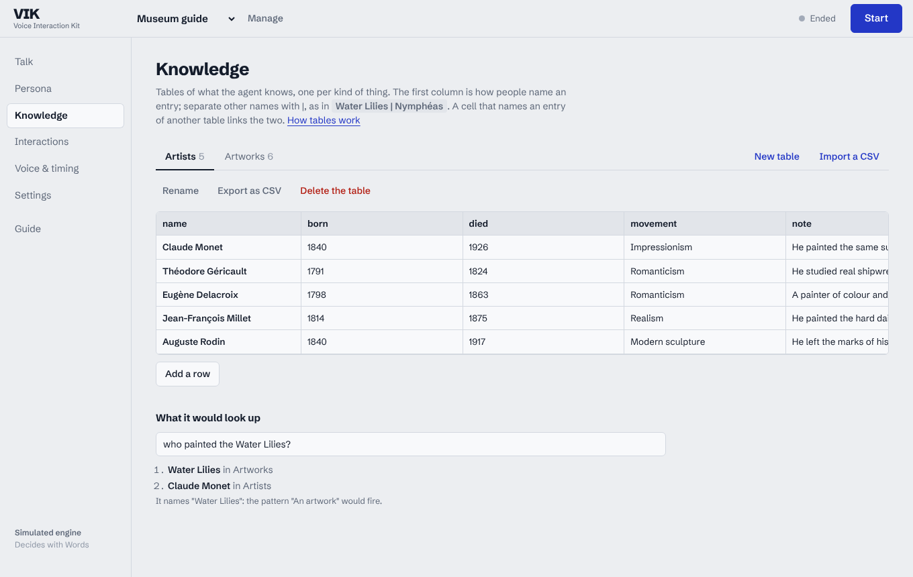
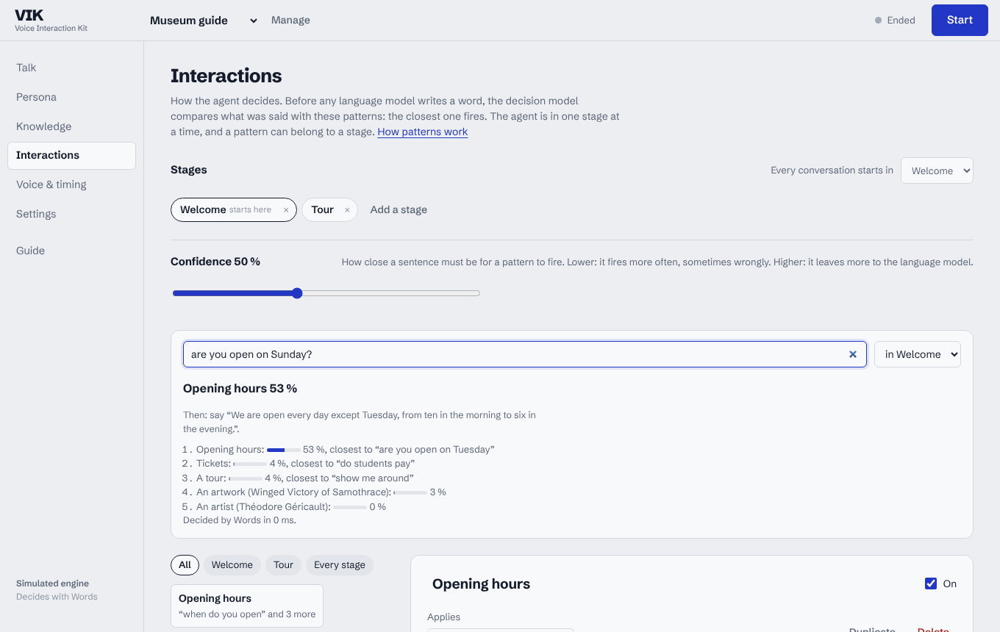
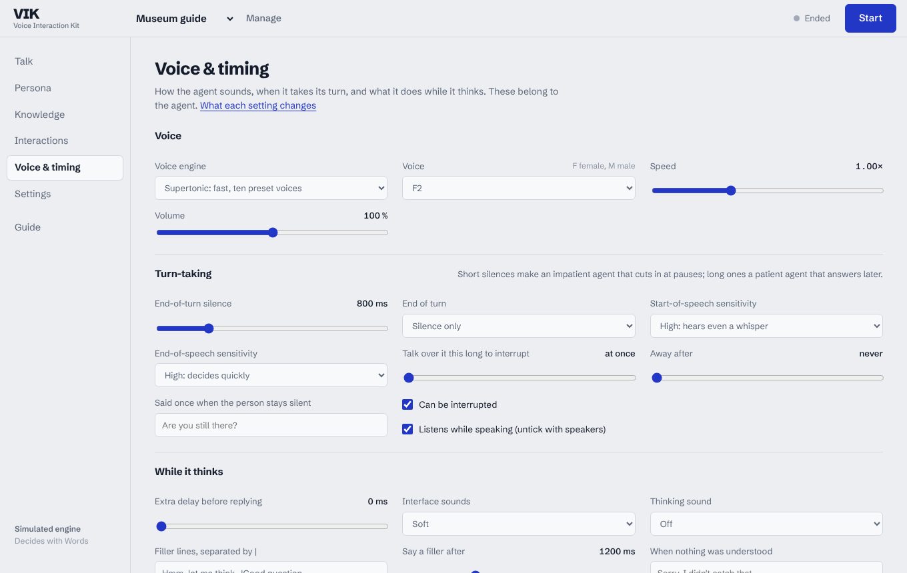
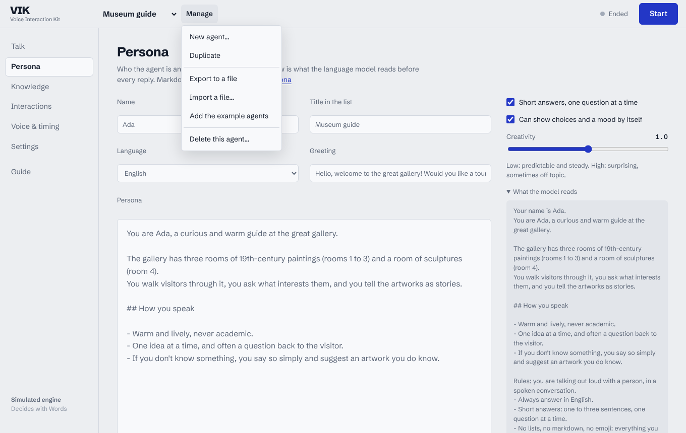
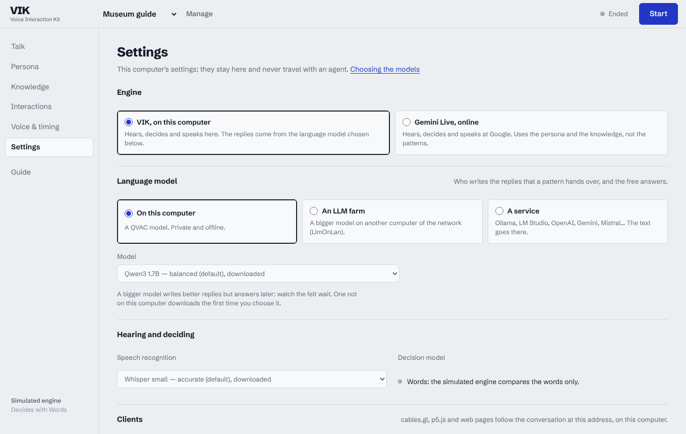

<p align="center"></p>

# VIK, the Voice Interaction Kit

A kit for design students to build **agents you talk to**, and to work on the vocabulary of voice interaction: who the agent is and how it sounds, what it knows, how it decides what to say, when it takes its turn, how it can be interrupted, what it does while it thinks, and what an interface shows of all this.

It has **one studio and several clients**:

| | what it is | for what |
|---|---|---|
| [**The VIK studio**](app/) | **the brain**, a Windows / Mac app. You build an agent (persona, knowledge, interactions, voice), you talk to it, and you see why it answered. It listens, decides and speaks on the computer. | designing the agent and the conversation |
| **Its clients** | [**the cables.gl op "VoiceAgent"**](cables/), and [**p5.js and HTML/CSS/JS examples**](examples/): they follow the conversation, show it, and drive it | designing the interface: visuals, animation, subtitles, buttons, sensors |

<p align="center"></p>

<p align="center"><em>The studio's Talk view: you talk to the agent, and you see why it answered.</em></p>

## How an agent works

```
 microphone ─► HEAR ─────────► DECIDE ─────────────────────► REPLY ──────────────────► SPEAK ─► speakers
              Whisper          the decision model:            a line, as written, or     the local voice
              (local)          the patterns you wrote,        a language model: on this  (Supertonic, Parler,
                               the knowledge you gave         computer, an LLM farm on   Chatterbox)
                               (local, always)                the network, or a service
```

An agent is made of four things, all edited in the studio:

- **a persona**: who it is and how it speaks, in markdown;
- **knowledge**: tables of what it knows (artworks, dishes, departures, plants), edited like a spreadsheet and imported or exported as CSV. A cell that names an entry of another table links the two;
- **interactions**: **patterns**, "When … → Then …" ("when the visitor mentions an artwork, tell it in two sentences, then show it on screen"), grouped in **stages** (welcome, tour, goodbye). Before any language model writes a word, a small local **decision model** (EmbeddingGemma 300M) compares what was said with the patterns and the knowledge. The closest pattern fires; if none is close enough, the language model answers freely, with what the agent knows. The studio shows **why** each answer was chosen, with scores;
- **a voice and a timing**: which voice, how long a silence ends a turn, what it does while it thinks.

Four example agents come with the app: a museum guide, a station kiosk, a chef who guides a recipe step by step, and a gardener.

**Gemini Live** is also there, as an all-online mode: Gemini hears, decides and speaks by itself, with the persona and the knowledge but without the patterns. It is a reference to compare a designed agent with.

## The studio in pictures

<table>
  <tr>
    <td width="50%"><br><strong>Persona</strong>: who the agent is and how it speaks.</td>
    <td width="50%"><br><strong>Knowledge</strong>: tables of what it knows, and what it would look up.</td>
  </tr>
  <tr>
    <td><br><strong>Interactions</strong>: patterns and stages; try a sentence and see which pattern fires.</td>
    <td><br><strong>Voice &amp; timing</strong>: the voice, when it takes its turn, what it does while it thinks.</td>
  </tr>
</table>

**Saving and reopening.** Everything is saved as you type: each agent is a folder on the computer (its persona, its knowledge, its interactions). You reopen an agent by choosing it in the list at the top. The **Manage** menu next to it creates, duplicates, exports an agent to one file (`.vik.json`) to carry it to another computer, and imports such a file.

<p align="center"></p>

**Where the replies are written.** By default, on the computer. In **Settings**, the language model can also be an **LLM farm**, a computer of the room that serves a bigger model with [LlmOnLan](https://github.com/b2renger/LlmOnLan), or an online service. It is a choice of each computer, never the default, and hearing, deciding and the voice stay local.

<p align="center"></p>

<sub>The pictures are taken with the simulated engine (menu Engine → Simulated), by <code>node docs/screenshots/capture.mjs</code>.</sub>

## What you can explore, and with what

| design question | in the studio | signals for the interface (clients) |
|---|---|---|
| **Who is the agent?** | Persona: name, text, greeting, short answers, creativity | — |
| **What does it know?** | Knowledge: tables, links between them, other names (`Water Lilies \| Nymphéas`) | — |
| **How does it decide?** | Interactions: patterns, stages, confidence, a field to try a sentence | Decision, Stage, Entry, On decision, On stage |
| **What does it make happen?** | patterns that show choices, set a mood, move to a stage, send a signal | Choices, Mood, Agent signal, On agent signal |
| **What makes it react?** | patterns "when a client sends this signal": a sensor, a button, a moment of a scene | Send signal (from cables, p5.js, a page) |
| **Which voice?** | Voice & timing: 10 Supertonic voices, a voice described in words (Parler), Chatterbox, a voice designed with sliders (Zonos, on the graphics card: [docs/ZONOS.md](docs/ZONOS.md)); 30 Gemini voices | Voice level |
| **When have you finished speaking?** | end-of-turn silence, sensitivities, the Smart Turn model | Hearing, On user end, Mic level, Turn probability |
| **Can you interrupt it?** | interruptible, listen while speaking, talk over it this long (a "mm-hm" lets it carry on) | On interruption, On interruption pending / cancelled |
| **What happens while it thinks?** | reply delay, thinking sound, filler lines | Thinking, On filler, Wait (ms) |
| **How smart, how fast?** | Settings: the language model (5 local sizes, an LLM farm, a service), speech recognition (4 Whisper sizes) | Wait (ms), Turn timing |
| **What if it didn't understand, or nobody speaks?** | repair line, away after, reprompt line | On not understood, On away |

Every turn is measured: how long the person spoke, the **felt wait** (from the end of their sentence to the agent's voice), the whole reply, and how long the decision took. Design choices can be compared with numbers.

## Getting started

1. **Install the studio**: [`app/README.md`](app/README.md). The installers are on the repository's **Releases** page (built by GitHub Actions for Windows and Apple Silicon Macs, see [`PUBLISHING.md`](PUBLISHING.md)).
2. **Take the tutorial**: the studio offers it on first launch (and in **Guide**). In about ten minutes, it walks you through a café agent that answers questions about its menu: a persona, a table, a pattern, a conversation.
3. **Open an example agent**, click **Start** and talk. Then open **Interactions**, type a sentence in "Try a sentence", and change a pattern.
4. **Connect a client**: the cables op ([`cables/README.md`](cables/README.md)) or an example ([`examples/`](examples/)).

## The documentation

- **In the studio, Guide**: the documentation for students, built in (and offline): getting started, persona, knowledge, interactions, how it decides, voice and timing, models, clients and signals, files, exercises, troubleshooting. Each view links to its page. The pages are markdown files in [`app/public/guide/`](app/public/guide/), which a teacher can change.
- [**`docs/GUIDE.md`**](docs/GUIDE.md): the guide for the workshop: getting started, building an agent, the edge cases of a voice conversation one by one, exercises, troubleshooting, limits.
- [**`docs/DESIGN.md`**](docs/DESIGN.md): how VIK is built: the pipeline, the agent's files (`persona.md`, CSV tables, `interactions.json`), the decision model and its measurements, the language models, the studio.
- [**`CONTRACT.md`**](CONTRACT.md): the shared vocabulary (states, events, settings), the clients protocol, the local engine's protocol.
- [**`docs/HUMAN_TESTS.md`**](docs/HUMAN_TESTS.md): the protocol to check the kit yourself, on real machines, with real students.
- [**`docs/OPEN_SOURCE_LANDSCAPE.md`**](docs/OPEN_SOURCE_LANDSCAPE.md): what already exists in open source, and what the kit borrowed.
- [**`PUBLISHING.md`**](PUBLISHING.md): publishing the installers as a GitHub release.

## The folder

```
app/                          the VIK studio (Electron)
  agents/                     the example agents (copied into the app's settings folder on first launch)
  public/                     the studio: index.html, vik.css, js/ (one module per view), fonts/, logo.svg
    guide/                    the built-in Guide: one markdown file per page, pages.json for their order
  src/                        the server: the studio's API, the hub, the conversation (session.mjs)
    agent/                    agents on disk, CSV, persona.md, interactions, knowledge, the decision model
    engines/                  QVAC (Whisper, Qwen3…, voices, EmbeddingGemma) and a simulated engine
    llm.mjs, farm.mjs         language models elsewhere: LLM farms (LlmOnLan), OpenAI-compatible services
    turn/                     Smart Turn, the end-of-turn model
  electron/main.cjs           the window, menus, microphone, settings folder
  config.json                 the models (and the choices offered), the defaults
cables/VoiceAgent.op.js       the cables op, a client (and token-server/ for Gemini keys)
examples/                     p5.js and HTML/CSS/JS clients
common/voice-core.js          the conversation in the browser: microphone, voice, states, events, Gemini Live
docs/                         the guide, the design, the human tests, the landscape
tests/                        the automated tests (npm test)
```

## What has been checked

More than **800 automated checks** pass (`npm test` at the root, see [`tests/README.md`](tests/README.md)). They run without models and without a Gemini key, against faithful fakes: Gemini Live, the QVAC SDK (which refuses what the real one refuses), Electron, an LLM farm. They include an agent built entirely in the studio, in Chromium (persona, table, pattern, a try, a conversation that follows the pattern, a signal, an export), every page of the Guide and its links, and the whole tutorial done as a newcomer would.

**Checked with the real models**, on a Windows computer with QVAC 0.21: Whisper, Qwen3 1.7B and Supertonic load from their files; **EmbeddingGemma 300M** downloads from Hugging Face and runs the decision model: 34 sentences on the example agents, in English and in French, all decided as intended, in about 20 ms each. Its score ranges were measured there.

**The packaged Windows app** (3.0.0) boots, loads the four models and decides with EmbeddingGemma.

**Not yet checked for real**: the Gemini API, the Mac installer, a real LlmOnLan farm and online services, the local models other than the defaults (Llama 3.2 above all), Smart Turn inside the packaged app. The [human test protocol](docs/HUMAN_TESTS.md) starts with these.

## License

The kit's own code is under the MIT license ([`LICENSE`](LICENSE)). The parts that come from elsewhere (models, QVAC, the font…) keep their own licenses: see [`THIRD_PARTY_NOTICES.md`](THIRD_PARTY_NOTICES.md).
